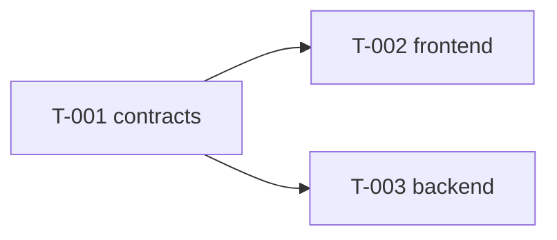

# 任务看板

> 由 coordinator 维护。前置任务全部合入的卡即为 **ready**；来自不同泳道的 ready 卡可以同时派发。

| 编号 | 标题 | 泳道 | 前置 | 状态 | 执行者 | PR |
|---|---|---|---|---|---|---|
| T-001 | 冻结 v1 契约 | contracts | — | ready | coordinator | |
| T-002 | 搭建骨架：frontend | frontend | T-001 | todo | | |
| T-003 | 搭建骨架：backend | backend | T-001 | todo | | |

## 依赖图

