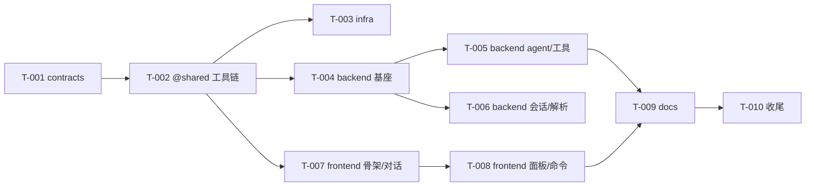

# 任务看板

> 由 coordinator 维护。前置任务全部合入的卡即为 **ready**；来自不同泳道的 ready 卡可以同时派发。
> 功能：`specs/001-agent-desktop/`。无 Git 远端，「PR」列为本地合入 `dev` 的分支名（见 plan.md Complexity Tracking）。

| 编号 | 标题 | 泳道 | 前置 | 状态 | 执行者 | PR |
|---|---|---|---|---|---|---|
| T-001 | 冻结 v1 契约与规格 | contracts | 无 | done | coordinator | `feat/contracts/T-001-spec-contracts`（本地 --no-ff 合入） |
| T-002 | 工具链与拆卡 | @shared | T-001 | done | coordinator | `int/T-002-toolchain`（本地 --no-ff 合入） |
| T-003 | lanes.conf 与 CI | infra | T-002 | done | coordinator | `feat/infra/T-003-ci-node22`（本地 --no-ff 合入） |
| T-004 | 主进程安全基座 | backend | T-002 | done | claude | `feat/backend/T-004-foundation`（本地 --no-ff 合入） |
| T-005 | Agent 核心与工具 | backend | T-004 | done | codex | `feat/backend/T-005-agent-tools`（本地 --no-ff 合入） |
| T-006 | 会话存储与 tasks 解析 | backend | T-004 | done | claude | `feat/backend/T-006-sessions-specs`（本地 --no-ff 合入） |
| T-007 | 渲染进程骨架与对话 | frontend | T-002 | done | codex | `feat/frontend/T-007-shell-chat`（本地 --no-ff 合入） |
| T-008 | Diff/终端/Tasks/会话/斜杠命令 | frontend | T-007 | done | claude | `feat/frontend/T-008-panels-commands`（本地 --no-ff 合入） |
| T-009 | 用户与测试/安全文档 | docs | T-005, T-008 | done | codex | `feat/docs/T-009-user-docs`（本地 --no-ff 合入） |
| T-010 | 收尾：路线图与看板 | @shared | T-009 | done | coordinator | `int/T-010-closeout`（本地 --no-ff 合入） |

## 依赖图

