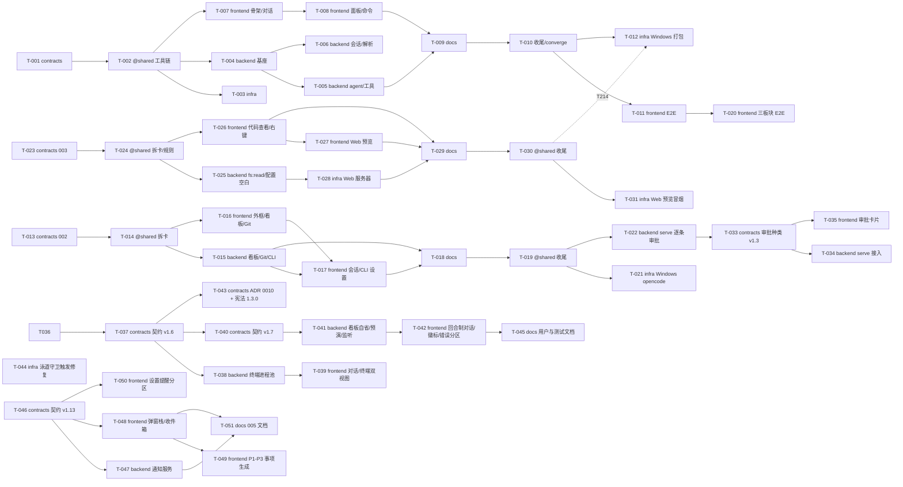

# 任务看板

> 由 coordinator 维护。前置任务全部合入的卡即为 **ready**；来自不同泳道的 ready 卡可以同时派发。
> 集成分支：以 `.agents/config.sh` 的 `INTEGRATION_BRANCH` 为准，当前为 `manus`（历史名依次为 `dev` → `hark-dev`）。下方「003 / 002 记录」是当时的历史事实，保留原样。
> 功能：`specs/001-agent-desktop/`（T-001…T-012）、`specs/002-workspace-boards/`（T-013…T-022）、`specs/003-code-view-web-locator/`（T-023…T-031）、`specs/005-approval-notifier/`（T-046…T-051）。当前 ready：T-020（frontend）、T-021（infra）、T-046（contracts）。下一步候选：contracts v1.4 暴露 opencodeMode 设置；真实 opencode serve 联调。T-012 同时承担 003 的 T214（打包核对）。
> 005 记录：审批通知提醒器由负责人提出、确认交互原型后立项（2026-10-21）：specs/005-approval-notifier/ 的 spec + checklists + tasks 随立项提交合入，FR 与规格内任务号统一 5xx 对齐规格号（历史偏移约定不再沿用，理由见 spec.md FR 节首注）；拆卡 T-046（contracts，ready）→ T-047（backend 通知服务）/ T-048（frontend 弹窗栈与收件箱）→ T-049（frontend P1–P3 事项，依赖 T-048）、T-050（frontend 设置分区）→ T-051（docs）。`.specify/feature.json` 已切到 005。
> 004 记录：T-037…T-045 一批（ADR 0010 终端模式 / 自动授权 + 看板自省 P0-1·P1-7·P1-8）此前在工作区未提交，卡片却已写「done」；本轮由 coordinator 按泳道拆分后逐支合入 `manus`：契约 v1.6（`b3c247c`）→ 契约 v1.7（`ebd00a9`）→ 后端 T-038（`2f189c8`）→ 后端 T-041（`7b332bc`）→ 前端 T-039/T-042（`dc17495`）→ infra T-044（`ba56b5a`）→ contracts T-043（`abe1fd8`）→ docs T-045（`7232917`）→ 看板与协作文档同步（`413a765`）→ 提交号修正（`ed77d77`）。约定：契约先行期间干净树 typecheck 预期为红（preload / handler 穷举检查），T-039 合入后转绿。
> 003 记录：T-023（契约 v1.2）合入提交 `cc62487` 到 T-025 合入提交 `7f900e1` 之间，`hark-dev` 因 preload / handler 编译期穷举检查而 typecheck 不通过（同 002，plan.md Complexity Tracking）；三者连续合入，其余每次合入后 lint / typecheck / 测试为绿。
> 002 记录：T-013（契约 v1.1）合入提交 `1ec10b8` 到 T-015 合入提交 `ce20063` 之间，`hark-dev` 因 preload / handler 编译期穷举检查而 typecheck 不通过（有意的防漏机制，plan.md Complexity Tracking）；二者已连续合入，其余每次合入后 `scripts/verify.sh` 为绿。集成分支已更名 `hark-dev`；任务分支合入后删除，状态以合并提交追溯。
> 说明：T015（应用入口/preload/handlers）因依赖后续模块，从 T-004 移到 T-006 执行（flow-back 已同步卡片）。无 Git 远端，「PR」列为本地合入 `dev` 的分支名（见 plan.md Complexity Tracking）。

| 编号 | 标题 | 泳道 | 前置 | 状态 | 执行者 | PR |
|---|---|---|---|---|---|---|
| T-001 | 冻结 v1 契约与规格 | contracts | 无 | done | coordinator | `feat/contracts/T-001-spec-contracts`（本地 --no-ff 合入） |
| T-002 | 工具链与拆卡 | @shared | T-001 | done | coordinator | `int/T-002-toolchain`（本地 --no-ff 合入） |
| T-003 | lanes.conf 与 CI | infra | T-002 | done | coordinator | `feat/infra/T-003-ci-node22`（本地 --no-ff 合入） |
| T-004 | 主进程安全基座 | backend | T-002 | done | claude | `feat/backend/T-004-foundation`（本地 --no-ff 合入） |
| T-005 | Agent 核心与工具 | backend | T-004 | done | codex | `feat/backend/T-005-agent-tools`（本地 --no-ff 合入） |
| T-006 | 会话存储与 tasks 解析 | backend | T-004 | done | claude | `feat/backend/T-006-sessions-specs`（本地 --no-ff 合入） |
| T-007 | 渲染进程骨架与对话 | frontend | T-002 | done | codex | `feat/frontend/T-007-shell-chat`（本地 --no-ff 合入） |
| T-008 | Diff/终端/Tasks/会话/斜杠命令 | frontend | T-007 | done | claude | `feat/frontend/T-008-panels-commands`（本地 --no-ff 合入） |
| T-009 | 用户与测试/安全文档 | docs | T-005, T-008 | done | codex | `feat/docs/T-009-user-docs`（本地 --no-ff 合入） |
| T-011 | Electron E2E 核心路径 | frontend | T-010 | done | hark | `feat/frontend/T-011-electron-e2e`（本地 --no-ff 合入；CI e2e 作业） |
| T-012 | Windows 打包验证与 CI | infra | T-010 | done | hark | `feat/infra/T-012-windows-ci`（已合入；windows-latest 首跑 run 39388669953 通过） |
| T-010 | 收尾：路线图与看板 | @shared | T-009 | done | coordinator | `int/T-010-closeout`（本地 --no-ff 合入） |
| T-013 | 功能 002 规格、契约 v1.1 与 ADR | contracts | 无 | done | coordinator | `feat/contracts/T-013-spec-002`（本地 --no-ff 合入） |
| T-014 | 002 拆卡与看板 | @shared | T-013 | done | coordinator | `int/T-014-split`（本地 --no-ff 合入） |
| T-015 | 主进程：看板 / Git 读取与 Agent CLI | backend | T-014 | done | coordinator | `feat/backend/T-015-workspace-agent-cli`（本地 --no-ff 合入） |
| T-016 | 渲染进程：原型外框、泳道看板、Git 视图 | frontend | T-014 | done | coordinator | `feat/frontend/T-016-shell-boards`（本地 --no-ff 合入） |
| T-017 | 渲染进程：任务会话板块与 Agent CLI 设置 | frontend | T-015, T-016 | done | coordinator | `feat/frontend/T-017-session-cli`（本地 --no-ff 合入） |
| T-018 | 002 用户与测试/安全文档 | docs | T-015, T-017 | done | coordinator | `feat/docs/T-018-docs-002`（本地 --no-ff 合入） |
| T-019 | 002 收尾：路线图与看板 | @shared | T-018 | done | coordinator | `feat/contracts/T-019-converge` + `int/T-019-closeout`（本地 --no-ff 合入） |
| T-020 | 三板块 Electron E2E | frontend | T-011 | ready | （待派发） | — |
| T-021 | Windows 实机验证 opencode 集成 | infra | T-019 | ready | （待派发） | — |
| T-022 | 评估 opencode serve 逐条工具审批 | backend | T-019 | done | hark | `feat/backend/T-022-opencode-serve`（本地 --no-ff 合入；原型未接入，结论见 ADR 0006 修订） |
| T-023 | 功能 003 规格、契约 v1.2 与 ADR | contracts | 无 | done | coordinator | `feat/contracts/T-023-spec-003`（本地 --no-ff 合入） |
| T-024 | 003 拆卡、测试规则与 Web 预览脚本入口 | @shared | T-023 | done | coordinator | `int/T-024-split`（本地 --no-ff 合入） |
| T-025 | 主进程：只读 fs:read 与 agent 配置默认空白 | backend | T-024 | done | coordinator | `feat/backend/T-025-file-read-config`（本地 --no-ff 合入） |
| T-026 | 渲染进程：代码查看器、全局右键发送与配置空白提示 | frontend | T-024 | done | coordinator | `feat/frontend/T-026-code-view-context-send`（本地 --no-ff 合入） |
| T-027 | Web 预览渲染层：只读适配器与 UI 定位 | frontend | T-026 | done | coordinator | `feat/frontend/T-027-web-preview`（本地 --no-ff 合入） |
| T-028 | Web 预览开发服务器 | infra | T-025 | done | coordinator | `feat/infra/T-028-web-dev-server`（本地 --no-ff 合入） |
| T-029 | 003 用户与测试 / 安全文档 | docs | T-026, T-027, T-028 | done | coordinator | `feat/docs/T-029-docs-003`（本地 --no-ff 合入） |
| T-030 | 003 收尾：路线图、看板与版本号 | @shared | T-029 | done | coordinator | `feat/contracts/T-030-converge` + `int/T-030-closeout`（本地 --no-ff 合入） |
| T-031 | Web 预览服务器自动化冒烟 | infra | T-030 | done | hark | `feat/infra/T-031-web-dev-smoke`（本地 --no-ff 合入） |
| T-032 | 界面重新设计：对齐 Claude MCP Apps 设计规范（ADR 0009） | frontend | T-030 | done | hark | `feat/contracts/T-032-adr-0009` + `feat/frontend/T-032-ui-redesign`（本地 --no-ff 合入） |
| T-033 | 契约 v1.3：ApprovalRequest 承载 opencode 其他权限类型 | contracts | T-022 | done | hark | `feat/contracts/T-033-approval-kinds`（本地 --no-ff 合入；后续 T127 backend / T128 frontend） |
| T-034 | opencode serve 逐条审批接入（实验开关） | backend | T-033 | done | hark | `feat/backend/T-034-opencode-serve-wire`（本地 --no-ff 合入） |
| T-035 | 新审批种类卡片 | frontend | T-033 | done | hark | `feat/frontend/T-035-approval-cards`（本地 --no-ff 合入） |
| T-036 | Web 预览 UI 修改记录器 | frontend | T-030 | done | hark | `feat/frontend/T-036-locator-recorder`（本地 --no-ff 合入） |
| T-037 | 契约 v1.6：终端模式通道与「全部允许」权限模式 | contracts | T-036 | done | codex / claude | `feat/contracts/T-037-contract-v1.6`（本地 --no-ff 合入 `b3c247c`） |
| T-038 | 主进程：终端进程池与「全部允许」权限落地 | backend | T-037 | done | codex / claude | `feat/backend/T-038-terminal-manager`（本地 --no-ff 合入 `2f189c8`） |
| T-039 | 渲染进程：任务会话「对话 / 终端」双视图 | frontend | T-038 | done | codex / claude | `feat/frontend/T-039-session-terminal-view`（本地 --no-ff 合入 `dc17495`；与 T-042 同提交） |
| T-040 | 契约 v1.7：集成分支引用回退、合入冲突预演与 git 引用变更事件 | contracts | T-037 | done | claude | `feat/contracts/T-040-contract-v1.7`（本地 --no-ff 合入 `ebd00a9`） |
| T-041 | 主进程：看板自省、合入冲突预演与 git 引用变化监听 | backend | T-040 | done | claude | `feat/backend/T-041-board-truth`（本地 --no-ff 合入 `7b332bc`） |
| T-042 | 渲染进程批次：回合制对话改版、活动徽标、错误分区与看板冲突预警 | frontend | T-041 | done | claude | `feat/frontend/T-039-session-terminal-view`（本地 --no-ff 合入 `dc17495`；与 T-039 同提交） |
| T-043 | ADR 0010（终端模式与自动授权）与宪法 1.3.0 | contracts | T-037 | done | claude | `feat/contracts/T-043-adr-0010-constitution`（本地 --no-ff 合入 `abe1fd8`） |
| T-044 | infra：泳道守卫按集成分支触发 + 集成分支名一致性检查 | infra | 无 | done | claude | `feat/infra/T-044-infra-batch`（本地 --no-ff 合入 `ba56b5a`） |
| T-045 | docs：终端双视图 / 自动授权 / 看板自省批次的用户与测试文档 | docs | T-042 | done | claude | `feat/docs/T-045-docs-batch`（本地 --no-ff 合入 `7232917`） |
| T-046 | 契约 v1.13：提醒事项、激活事件与提醒偏好 | contracts | 无 | ready | （待派发） | — |
| T-047 | 主进程通知服务：审批 / 出错系统通知与点击激活 | backend | T-046 | blocked | （待派发） | — |
| T-048 | 提醒弹窗栈与待办收件箱（P0 主线） | frontend | T-046 | blocked | （待派发） | — |
| T-049 | P1–P3 事项生成：受阻 / 出错 / 待审查 / 新 ready | frontend | T-048 | blocked | （待派发） | — |
| T-050 | 设置页提醒分区 | frontend | T-046 | blocked | （待派发） | — |
| T-051 | 005 用户与测试文档 | docs | T-047, T-048 | blocked | （待派发） | — |

## 依赖图

